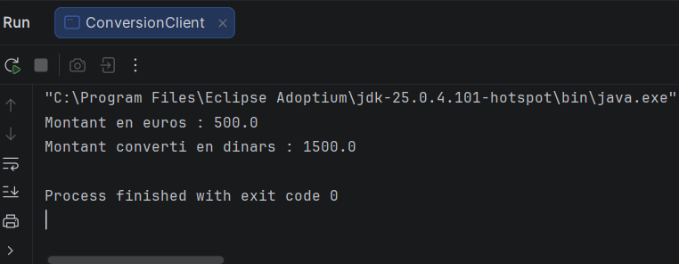

# TP 5 — Invocation de méthodes sur des objets distants avec Java RMI

**Nom et prénom :** karama haj amor  
**Classe :** LSI 3  - groupe 1_2
**Matière :** Développement d’applications réparties  

## Présentation

Ce TP consiste à développer une application répartie de conversion de devises. Le serveur publie un service RMI qui convertit un montant en euros vers le dinar. Le client récupère la référence de cet objet distant dans le registre RMI et appelle sa méthode de conversion.

## Étape 2 — Développement du serveur

Le serveur a été créé dans un projet Java nommé `RMIConversion_Server`.

### Interface distante `IConversion`

Dans le package `rmiService`, l’interface `IConversion` étend `Remote` et déclare la méthode distante `convertirMontant`. Cette méthode reçoit le montant en euros et renvoie le montant converti en dinars.

```java
package rmiService;

import java.rmi.Remote;
import java.rmi.RemoteException;

public interface IConversion extends Remote {
    double convertirMontant(double mt) throws RemoteException;
}
```

### Implémentation `ConversionImpl`

La classe `ConversionImpl`, placée dans le package `rmiService`, implémente l’interface distante. Elle contient le calcul de conversion utilisé par le service.

Le résultat de l’exécution pour 500 euros est de 1 500 dinars, selon le taux défini dans cette classe.

### Serveur `ConversionServer`

La classe `ConversionServer`, placée dans le package `rmiServer`, démarre le registre RMI sur le port `1099`, crée une instance de `ConversionImpl` et publie le service sous le nom `BK`.

```java
Naming.rebind("rmi://localhost:1099/BK", od);
```

Le nom `BK` doit être identique à celui recherché par le client.

### Export de l’interface dans `conversionClient.jar`

L’interface distante a été exportée dans le fichier `conversionClient.jar`. Ce JAR contient `rmiService/IConversion.class`, mais pas `ConversionImpl`, qui reste côté serveur.

Le fichier `conversionClient.jar` a ensuite été placé dans le dossier `libs` du projet client et ajouté à ses dépendances.

## Étape 3 — Développement du client

Un nouveau projet Java nommé `RMIConversion_Client` a été créé.

Dans ce projet, le package `rmiClient` contient la classe `ConversionClient`. Le client recherche le service `BK` dans le registre RMI, récupère sa référence sous le type `IConversion` et appelle `convertirMontant(500)`.

```java
Registry registry = LocateRegistry.getRegistry("localhost", 1099);

IConversion conversion =
        (IConversion) registry.lookup("BK");

double resultat = conversion.convertirMontant(500.0);
```

L’interface `IConversion` est accessible au client grâce au fichier `conversionClient.jar`.

## Étape 4 — Exécution de l’application

Le serveur RMI a été lancé en premier. Il a démarré le registre et publié le service `BK`.

Le client a ensuite été exécuté. Il a cherché le service dans l’annuaire, appelé la méthode distante avec le montant de 500 euros, puis affiché le résultat reçu.

```text
Montant en euros : 500.0
Montant converti en dinars : 1500.0
```



## Étape 5 — Dépôt du livrable

Le projet, le README et le résultat ont été préparés pour le dépôt sur GitHub. Le lien du dépôt GitHub doit être transmis sur la plateforme ENT conformément à la consigne.

## Synthèse

Ce TP m’a permis de mettre en œuvre un service distant avec Java RMI. Le serveur démarre un registre, crée une implémentation de l’interface `IConversion` et la publie sous le nom `BK`. Le client utilise le JAR contenant l’interface distante pour rechercher le service, invoquer `convertirMontant(500)` et afficher le résultat obtenu.